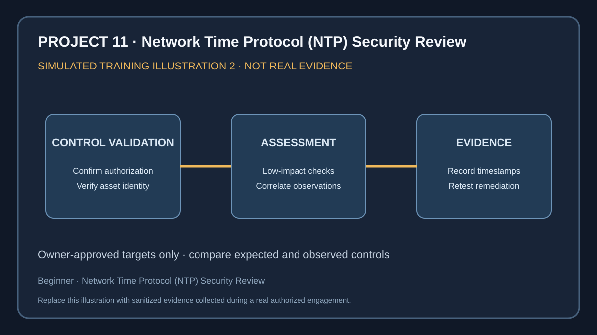

# Project 11: Network Time Protocol (NTP) Security Review

**Level:** Beginner  
**Status:** Training project  
**Domain:** Network penetration testing

## Overview

This exercise focuses on **network time protocol (ntp) security review**. Review NTP source trust, exposure, client configuration, and monitoring without changing system clocks. The goal is a repeatable assessment with defensible evidence, limitations, risk context, and practical remediation.

## Objectives

- Define the security question and expected control outcome.
- Collect evidence using the least intrusive method that answers the question.
- Correlate observations with asset ownership and configuration evidence.
- Separate confirmed facts from assumptions and scanner inference.
- Prioritize risks and define measurable remediation and retest criteria.

## Authorization and scope

Perform this project only on systems you own or have explicit written permission to assess. Use an isolated host-only/internal lab network for active checks. Record exact IPs, ports, protocols, test window, rate limits, exclusions, system owner, emergency contact, and stop conditions in a signed rules-of-engagement document. Do not scan public ranges, shared hosting, neighboring networks, or production systems without separate written authorization. No denial-of-service, password guessing, credential harvesting, persistence, or destructive changes are part of this exercise. Stop if an unexpected host responds or service stability changes.

**Placeholders:** `LAB_TARGET` is one authorized lab host; `LAB_CIDR` is one isolated approved subnet; `LAB_IFACE` is the lab-only interface. Verify values and routes before running commands.

## Prerequisites and tools

chronyc/ntpq, NTP configuration

Also prepare a clean evidence folder, timestamped notes, tool versions, asset owner, and current network diagram or configuration export.

## Lab architecture

```text
[Assessment workstation] -- [Isolated lab switch] -- [Approved target(s)]
             |                                      |
             +---------- [Evidence / logs] --------+
```

Keep the assessment interface separate from bridged/public networking. For configuration audits, prefer sanitized read-only exports and do not alter device settings during evidence collection.

## Walkthrough

1. **Pre-engagement:** Confirm written authorization, target ownership, exact scope, window, and stop conditions.
2. **Baseline:** Record source interface, routes, target identity, relevant configuration, and current service state.
3. **Collection:** Review NTP source trust, exposure, client configuration, and monitoring without changing system clocks.
4. **Correlation:** Compare tool output with asset inventory, approved architecture, vendor baseline, and owner confirmation.
5. **Validation:** Corroborate material observations with a second evidence source or controlled positive/negative test.
6. **Analysis:** Document exposure, prerequisites, business impact, likelihood, affected assets, and compensating controls.
7. **Remediation:** Recommend least-privilege changes with an owner, priority, and target date.
8. **Retest:** Repeat the same safe check after change approval and retain before/after evidence.

### Example command or review procedure

Use only in an isolated authorized lab. Adapt syntax to the installed tool version and do not broaden target scope.

```bash
chronyc tracking
chronyc sources -v
```

## Expected observations

Capture asset identity, exact observation, evidence source, timestamp/time zone, source host, confidence, exposure, business role, and control context. For discovery, distinguish reachable, filtered, and unknown states. For service review, distinguish a banner from a confirmed product/version. For policy review, record expected and observed behavior for each approved test flow. A timeout or `open|filtered` result is not proof of a vulnerability.

| Field | Record |
|---|---|
| Asset | Owner-confirmed hostname, IP, role, environment |
| Observation | Service, setting, policy outcome, or packet behavior |
| Evidence | Command/output, config, console, PCAP, or owner statement |
| Confidence | Confirmed / strongly indicated / unverified |
| Exposure | Source zone, destination, port/protocol, access prerequisite |
| Impact | Confidentiality, integrity, availability, operational consequence |
| Existing controls | ACL, MFA, segmentation, monitoring, compensating control |

## Risk assessment

Use the organization's approved risk model. If unavailable, document qualitative severity and rationale: High for material exposure of critical services with credible impact; Medium for meaningful weaknesses requiring additional conditions or affecting limited scope; Low for hardening opportunities with limited direct impact; Informational for inventory observations without a demonstrated weakness. Do not use scanner severity alone. If no issue is observed within scope, report that accurately rather than inventing a finding.

## Remediation guidance

- Remove unnecessary listeners and restrict access to named source zones and management hosts.
- Prefer vendor-supported encrypted protocols and secure configuration baselines.
- Apply least privilege to identities, services, shares, management interfaces, and network paths.
- Centralize authentication, time synchronization, logging, alerting, and configuration backup.
- Document exceptions with a business owner, compensating control, and expiry date.
- Route production changes through approved change management.

## Validation and retest

Repeat the original approved check after remediation. Confirm the weakness is addressed, required business connectivity still works, relevant monitoring is active, and the system owner signs off. Record residual risk and any accepted exception.

## Evidence and deliverables

Deliver a scope record, methodology notes, sanitized output, asset/service table, topology or flow diagram where relevant, finding records, remediation plan, and retest summary. Redact credentials, tokens, personal data, and unrelated systems before publishing.

```text
Finding ID: NET-11-001
Title: [concise observation]
Asset: [owner-confirmed lab asset]
Evidence: [file + timestamp]
Severity: [rating + rationale]
Impact: [business consequence]
Recommendation: [specific control change]
Retest: [method + outcome]
Status: [open / remediated / accepted]
```

## Framework references

Use mappings only where evidence supports them. Potential references include NIST SP 800-115 for technical testing methodology, NIST CSF 2.0 for Protect/Detect outcomes, CIS Controls v8 for secure configuration, network infrastructure management, and audit logging, plus relevant vendor hardening guidance. A single technical test does not establish compliance or certification.

## Completion checklist

- [ ] Written authorization and exact scope recorded
- [ ] Lab isolation and target ownership verified
- [ ] Baseline and tool versions captured
- [ ] Checks completed within approved limits
- [ ] Observations corroborated and uncertainty documented
- [ ] Risks prioritized with business context
- [ ] Remediation and retest criteria written
- [ ] Evidence sanitized and report reviewed

## Simulated training illustrations

These are **simulated training illustrations**, not screenshots from a real scan, device, customer, or engagement. Do not represent them as actual assessment evidence.





---

**Lab-only exercise:** follow documented authorization boundaries and applicable vendor guidance.
